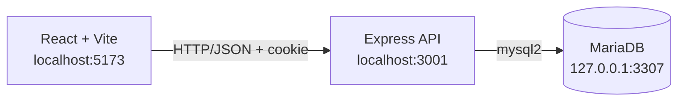

# Project Planner

> Персональная Kanban-доска для управления задачами, статусами и приоритетами.


Project Planner помогает вести задачи в четырех этапах: **Очередь**, **В работе**, **На проверке** и **Готово**. Учетные записи и задачи хранятся на сервере, поэтому доска не зависит от одного браузера или устройства.

## Возможности

| Область | Что доступно |
| --- | --- |
| Авторизация | Регистрация, вход, проверка сессии и выход |
| Kanban | Четыре статуса и перенос карточек Drag & Drop |
| Задачи | Создание, редактирование, удаление и очистка доски |
| Приоритеты | Низкий, средний и высокий |
| Хранение | MariaDB с привязкой каждой задачи к пользователю |
| Интерфейс | React-компоненты, модальные формы и контекстные действия |

## Архитектура



Frontend не подключается к базе напрямую. Backend управляет сессиями, проверяет пользователя и выполняет операции с задачами только в его области данных.

## Технологии

- **Frontend:** React 18, Vite, JavaScript/JSX, CSS.
- **Drag & Drop:** `react-dnd` и `react-dnd-html5-backend`.
- **Backend:** Node.js, Express 5, Fetch API.
- **Database:** MariaDB, `mysql2` connection pool.
- **Auth:** `express-session`, `bcryptjs`, HttpOnly cookie.
- **Документация:** Markdown и Mermaid.

Подробное описание находится в [`docs/technical_description.md`](docs/technical_description.md), а список технологий - в [`docs/technological_stack.md`](docs/technological_stack.md).

## Быстрый старт

### Требования

- Node.js и npm;
- MariaDB;
- доступ к локальному порту `3307`.

Порт `3307` используется, чтобы не пересекаться с Docker-контейнером `DB-labs`, который занимает `3306`.

### 1. Установка зависимостей

```bash
git clone https://github.com/yurbas-art/project-planner.git
cd project-planner
npm install --legacy-peer-deps
```

### 2. Настройка окружения

Создайте `server/.env` на основе `server/.env.example`:

```env
PORT=3001
CLIENT_URL=http://localhost:5173
DB_HOST=127.0.0.1
DB_PORT=3307
DB_NAME=project_planner_auth
DB_USER=yurbas_2007
DB_PASSWORD=your_password
SESSION_SECRET=change-this-secret
```

Файл `server/.env` не нужно добавлять в Git.

### 3. Подготовка базы данных

Убедитесь, что MariaDB запущена на `127.0.0.1:3307`, затем выполните схему:

```bash
sudo mariadb < server/schema.sql
```

Схема создает базы `users` и `tasks`. При повторном запуске существующие пользователи не удаляются.

Пользователь приложения должен иметь права на базу `project_planner_auth`.

### 4. Запуск

Запустить frontend и backend одновременно:

```bash
npm run dev:full
```

Или в двух терминалах:

```bash
npm run server
npm run dev
```

После запуска:

- приложение: http://localhost:5173;
- API: http://localhost:3001;
- health check: http://localhost:3001/api/health.

## API

### Авторизация

```text
POST /api/auth/register
POST /api/auth/login
GET  /api/auth/me
POST /api/auth/logout
```

### Задачи

```text
GET    /api/tasks
POST   /api/tasks
PATCH  /api/tasks/:id
DELETE /api/tasks/:id
DELETE /api/tasks
```

Все запросы к задачам требуют активной сессии. Подробные форматы запросов и ответов описаны в технической документации.

## Проверка

Production-сборка frontend:

```bash
npm run build
```

Минимальный ручной сценарий:

1. Зарегистрировать пользователя.
2. Создать задачу.
3. Перетащить карточку в другую колонку.
4. Изменить название или приоритет.
5. Перезагрузить страницу и проверить сохранение в MariaDB.
6. Выйти и войти снова.

## Ограничения текущей версии

- Стандартное хранилище `express-session` подходит для разработки; для production нужен внешний session store.
- Автоматические unit- и integration-тесты пока не настроены.
- Совместные проекты, роли и приглашение участников пока не реализованы.

## Лицензия

Проект распространяется по лицензии MIT. Подробности находятся в [`docs/LICENSE.md`](docs/LICENSE.md).
