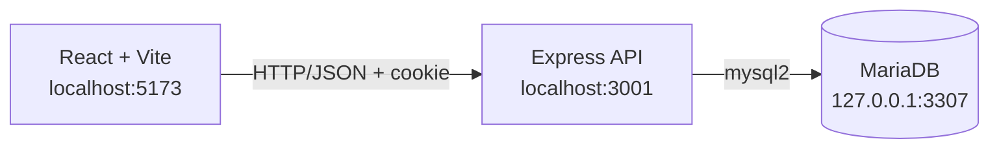

# Project Planner

> Персональная Kanban-доска для управления задачами, статусами и приоритетами.


Project Planner - веб-приложение для управления задачами на Kanban-доске. Пользователь создает карточки, назначает приоритет, редактирует задачи и перемещает их между этапами: **Очередь**, **В работе**, **На проверке** и **Готово**.

Учетные записи и задачи хранятся в MariaDB. Frontend обращается к базе только через Express API, а доступ к задачам ограничен текущей пользовательской сессией.

## Возможности

- регистрация, вход, проверка сессии и выход;
- создание, редактирование и удаление задач;
- очистка всех задач текущего пользователя;
- Drag & Drop между Kanban-колонками;
- приоритеты: низкий, средний и высокий;
- серверное хранение задач с привязкой к пользователю;
- Docker Compose для запуска всего стека;

## Архитектура



Приложение разделено на четыре уровня:

1. **Frontend** отображает интерфейс и отправляет запросы.
2. **Backend** управляет сессиями, проверяет пользователя и выполняет операции с задачами.
3. **MariaDB** хранит пользователей и задачи.

## Технологии

| Уровень | Технологии |
| --- | --- |
| Интерфейс | React 18, JavaScript/JSX, CSS |
| Сборка | Vite 8 |
| Drag & Drop | `react-dnd`, `react-dnd-html5-backend` |
| Сервер | Node.js, Express 5 |
| База данных | MariaDB, `mysql2` |
| Авторизация | `express-session`, `bcryptjs`, HttpOnly cookie |
| Инфраструктура | Docker Compose, Nginx |
| Документация | Markdown, Mermaid |

Подробности находятся в [`docs/technical_description.md`](docs/technical_description.md) и [`docs/technological_stack.md`](docs/technological_stack.md).

## Быстрый старт

### Требования

- Node.js и npm;
- Docker Engine и Docker Compose;
- свободные порты `3001`, `3307` и `5173`.


### Установка

```bash
git clone https://github.com/yurbas-art/project-planner.git
cd project-planner
npm install --legacy-peer-deps
```

### Запуск в Docker

Docker Compose запускает frontend, Express API и MariaDB. Этот вариант не использует системную MariaDB и не изменяет контейнер `DB-labs`.

Создайте файл переменных и измените пароли:

```bash
cp .env.docker.example .env.docker
```

Затем запустите стек:

```bash
npm run docker:up
```

Адреса сервисов:

- приложение: http://localhost:5173;
- API: http://localhost:3001;

Остановить контейнеры и посмотреть логи:

```bash
npm run docker:down
npm run docker:logs
```

### Настройка окружения без Docker

Для запуска backend напрямую скопируйте `server/.env.example` в `server/.env`:

```bash
cp server/.env.example server/.env
```

```env
PORT=3001
CLIENT_URL=http://localhost:5173
DB_HOST=127.0.0.1
DB_PORT=3307
DB_NAME=project_planner_auth
DB_USER=your_database_user
DB_PASSWORD=your_database_password
SESSION_SECRET=change-this-secret
```

`server/.env` содержит секреты и не должен добавляться в Git.

### Подготовка базы данных без Docker

Убедитесь, что MariaDB запущена на `127.0.0.1:3307`, а пользователь приложения имеет права на базу `project_planner_auth`. Затем примените схему:

```bash
sudo mariadb < server/schema.sql
```

Скрипт создает базу `project_planner_auth` и таблицы `users` и `tasks`. Повторный запуск не удаляет существующие данные.

### Запуск без Docker

```bash
npm run server
npm run dev
```

В этом режиме MariaDB должна быть запущена отдельно на `127.0.0.1:3307`.

## API

### Авторизация

```text
POST /api/auth/register  Регистрация
POST /api/auth/login     Вход
GET  /api/auth/me        Текущий пользователь
POST /api/auth/logout    Выход
```

### Задачи

```text
GET    /api/tasks        Получить задачи текущего пользователя
POST   /api/tasks        Создать задачу
PATCH  /api/tasks/:id    Изменить задачу или ее статус
DELETE /api/tasks/:id    Удалить задачу
DELETE /api/tasks        Удалить все задачи пользователя
```

Все маршруты `/api/tasks` требуют активной сессии. Backend дополнительно фильтрует запросы по `user_id`, поэтому пользователь не получает доступ к чужим задачам.

## Проверка

Собрать production-версию frontend:

```bash
npm run build
```

Минимальный ручной сценарий:

1. Зарегистрировать пользователя.
2. Создать задачу.
3. Перетащить карточку в другую колонку.
4. Изменить название или приоритет.
5. Перезагрузить страницу и убедиться, что задача загрузилась из MariaDB.
6. Выйти и войти снова.

## Структура проекта

```text
src/                React-приложение
src/api/            HTTP-клиент frontend
src/components/     Auth, Header, Board и модальные окна
server/server.js    Express API и маршруты
server/db.js        Пул подключений MariaDB
server/schema.sql   Схема базы данных
docker-compose.yml  Docker Compose для frontend, API и MariaDB
docker/             Dockerfiles и Nginx
docs/               Техническая документация
```

## Ограничения

- стандартное хранилище `express-session` подходит для разработки; для production нужен внешний session store;
- автоматические unit- и integration-тесты пока не настроены;
- совместные проекты, роли и приглашение участников пока не реализованы.

## Лицензия

Проект распространяется по лицензии MIT. Подробности находятся в [`docs/LICENSE.md`](docs/LICENSE.md).
