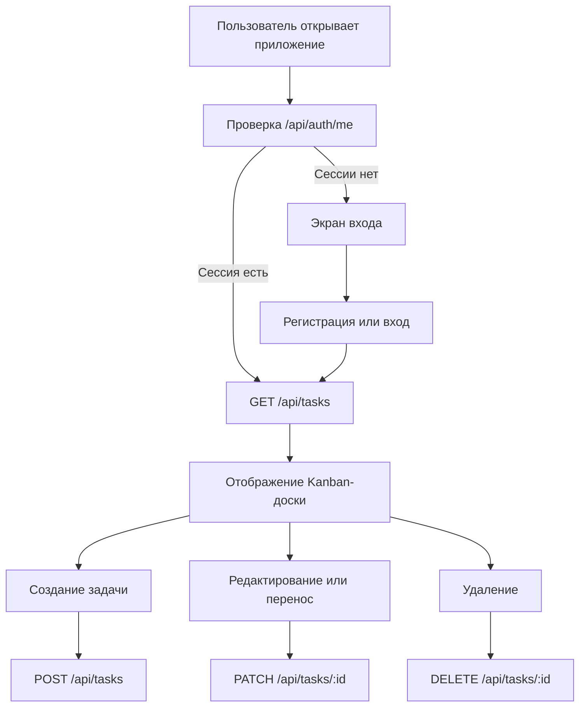

# Техническое описание Project Planner

## 1. Назначение проекта

Project Planner - веб-приложение для управления задачами с использованием Kanban-доски. Приложение позволяет пользователю создавать карточки, назначать им приоритет и статус, редактировать описание, перемещать задачи между этапами работы и удалять их.

После добавления авторизации данные пользователя и его задачи хранятся в MariaDB. Это позволяет загружать одну и ту же доску после повторного входа или с другого клиентского устройства.

## 2. Архитектура решения

Проект состоит из frontend, backend и базы данных.

```text
Браузер
  |
  | React UI, Fetch API, cookie session
  v
Vite frontend :5173
  |
  | HTTP/JSON with credentials
  v
Express API :3001
  |
  | mysql2 connection pool
  v
MariaDB :3307
```

Frontend отвечает за отображение интерфейса и локальное состояние текущего экрана. Backend отвечает за авторизацию, проверку сессии, работу с базой и операции с задачами. База данных является постоянным хранилищем учетных записей и задач.

Прямое подключение браузера к MariaDB не используется.

## 3. Структура проекта

```text
project-planner/
├── docs/
│   ├── technological_stack.md
│   └── technical_description.md
├── public/
├── server/
│   ├── .env
│   ├── .env.example
│   ├── db.js
│   ├── schema.sql
│   └── server.js
├── src/
│   ├── api/
│   │   └── api.js
│   ├── components/
│   │   ├── auth/
│   │   ├── board/
│   │   ├── header/
│   │   ├── modal/
│   │   └── ContextMenu/
│   ├── App.jsx
│   ├── App.css
│   ├── index.css
│   └── main.jsx
├── index.html
├── package.json
└── vite.config.js
```

## 4. Frontend

### 4.1. Инициализация

Точка входа frontend - `src/main.jsx`. React монтирует компонент `App` в элемент `#root` из `index.html`.

`src/App.jsx` является корневым компонентом приложения. Он:

- проверяет текущую сессию через `/api/auth/me`;
- показывает экран авторизации до входа пользователя;
- загружает задачи после успешной авторизации;
- передает задачи и callbacks Kanban-доске;
- управляет открытием модальных окон;
- выполняет CRUD-операции через `taskApi`.

### 4.2. Авторизация

`src/components/auth/AuthScreen.jsx` содержит формы входа и регистрации. Один компонент переключается между двумя режимами:

- вход: email и пароль;
- регистрация: имя, email и пароль.

После успешного запроса backend возвращает публичные данные пользователя. Frontend сохраняет их в состоянии `App`, после чего показывает основную доску.

### 4.3. Kanban-доска

Компонент `Board` отображает четыре фиксированные колонки:

1. «Очередь»;
2. «В работе»;
3. «На проверке»;
4. «Готово».

`Column` фильтрует общий массив задач по полю `status`. `Card` отображает отдельную задачу и передает действия в `App`.

Drag & Drop реализован с помощью `react-dnd`. При переносе карточки вызывается `onMoveTask`, который отправляет `PATCH /api/tasks/:id` с новым статусом.

### 4.4. Модальные окна

- `TaskModal` - создание задачи;
- `TaskViewModal` - редактирование задачи;
- `SettingsModal` - настройки доски и очистка задач.

Форма задачи использует поля:

```text
title    - название
 desc    - описание
priority - низкий, средний или высокий
status   - текущая колонка
```

В базе поле `desc` преобразуется в `description`, а при ответе API преобразуется обратно в формат, который использует frontend.

## 5. Backend

Сервер запускается из `server/server.js` и слушает порт из переменной `PORT`. По умолчанию используется порт `3001`.

При запуске сервер:

1. загружает переменные из `server/.env`;
2. создает CORS-настройки для frontend;
3. включает JSON body parser;
4. создает Express-сессию;
5. регистрирует auth и task routes;
6. начинает прослушивание HTTP-порта.

Подключение к MariaDB реализовано в `server/db.js` через `mysql2/promise` и pool соединений.

## 6. Конфигурация окружения

Файл `server/.env` не должен попадать в Git. Шаблон параметров находится в `server/.env.example`.

```env
PORT=3001
CLIENT_URL=http://localhost:5173
DB_HOST=127.0.0.1
DB_PORT=3307
DB_NAME=project_planner_auth
DB_USER=yurbas_2007
DB_PASSWORD=...
SESSION_SECRET=...
```

Порт `3307` выбран потому, что Docker-контейнер `DB-labs` использует порт `3306`. Контейнер не изменяется проектом.

## 7. Модель данных

### 7.1. `users`

```text
id            INT UNSIGNED, primary key
name          VARCHAR(100)
email         VARCHAR(255), unique
password_hash VARCHAR(255)
created_at    TIMESTAMP
```

`email` используется для входа и не может повторяться. Поле `password_hash` содержит результат хеширования пароля через `bcryptjs`.

### 7.2. `tasks`

```text
id          INT UNSIGNED, primary key
user_id     INT UNSIGNED, foreign key -> users.id
title       VARCHAR(255)
description TEXT
priority    ENUM('низкий', 'средний', 'высокий')
status      ENUM('Очередь', 'В работе', 'На проверке', 'Готово')
created_at  TIMESTAMP
updated_at  TIMESTAMP
```

Связь `tasks.user_id -> users.id` обеспечивает принадлежность задачи пользователю. При удалении пользователя его задачи удаляются через `ON DELETE CASCADE`.

Индекс `(user_id, status)` ускоряет выборку задач пользователя по Kanban-статусу.

## 8. API-контракт

Все запросы frontend отправляет с `credentials: "include"`, чтобы браузер передавал cookie сессии.

### 8.1. Регистрация

```http
POST /api/auth/register
Content-Type: application/json
```

Тело запроса:

```json
{
  "name": "Иван",
  "email": "ivan@example.com",
  "password": "secret123"
}
```

Успешный ответ имеет статус `201` и содержит объект `user`.

### 8.2. Вход

```http
POST /api/auth/login
Content-Type: application/json
```

```json
{
  "email": "ivan@example.com",
  "password": "secret123"
}
```

При успехе сервер создает сессию и возвращает пользователя. При неверных данных возвращается `401`.

### 8.3. Текущий пользователь и выход

```http
GET  /api/auth/me
POST /api/auth/logout
```

`/api/auth/me` возвращает `401`, если активная сессия отсутствует. Выход уничтожает сессию и очищает cookie.

### 8.4. Получение задач

```http
GET /api/tasks
```

Ответ:

```json
{
  "tasks": [
    {
      "id": 1,
      "title": "Подготовить отчет",
      "desc": "Собрать результаты",
      "priority": "высокий",
      "status": "В работе",
      "createdAt": "2026-10-17T10:00:00.000Z"
    }
  ]
}
```

Возвращаются только задачи пользователя из текущей сессии.

### 8.5. Создание, изменение и удаление

```http
POST   /api/tasks
PATCH  /api/tasks/:id
DELETE /api/tasks/:id
DELETE /api/tasks
```

`PATCH` используется как для редактирования данных карточки, так и для изменения статуса при Drag & Drop. `DELETE /api/tasks` удаляет все задачи текущего пользователя.

## 9. Аутентификация и сессии

При регистрации или входе сервер записывает в session объект с публичными данными пользователя:

```js
{
  id,
  name,
  email
}
```

Пароль в сессию не записывается.

Маршруты задач используют middleware `requireAuth`. Middleware проверяет наличие `req.session.user`. SQL-запросы дополнительно фильтруют записи по `user_id`, поэтому идентификатор задачи сам по себе не дает доступ к чужой задаче.

В текущей версии Express использует стандартное хранилище сессий в памяти. Это подходит для локальной разработки, но для production потребуется Redis или другое общее хранилище сессий.

## 10. Жизненный цикл задачи



## 11. Установка и запуск

Требования:

- Node.js;
- npm;
- MariaDB;
- доступ пользователя приложения к базе `project_planner_auth`.

Установка зависимостей:

```bash
npm install
```

Создание таблиц:

```bash
sudo mariadb < server/schema.sql
```

Запуск обоих процессов:

```bash
npm run dev:full
```

Или раздельно:

```bash
npm run server
npm run dev
```

Production-сборка frontend:

```bash
npm run build
```

## 12. Проверка работоспособности

Минимальная ручная проверка:

1. Открыть frontend.
2. Зарегистрировать пользователя.
3. Выйти и войти повторно.
4. Создать задачу.
5. Перезагрузить страницу и убедиться, что задача загружается из MariaDB.
6. Отредактировать название или приоритет.
7. Перетащить карточку в другую колонку.
8. Удалить задачу.
9. Войти под другим пользователем и убедиться, что чужая задача не отображается.

## 13. Ограничения и дальнейшее развитие

Текущая реализация сознательно ограничена базовой авторизацией и серверным хранением задач. Пока не добавлены:

- проекты и совместная работа нескольких пользователей;
- роли и права администратора;
- внешний session store;
- автоматические unit- и integration-тесты;
- production-логирование и rate limiting;
- миграции базы данных вместо повторного выполнения `schema.sql`.
